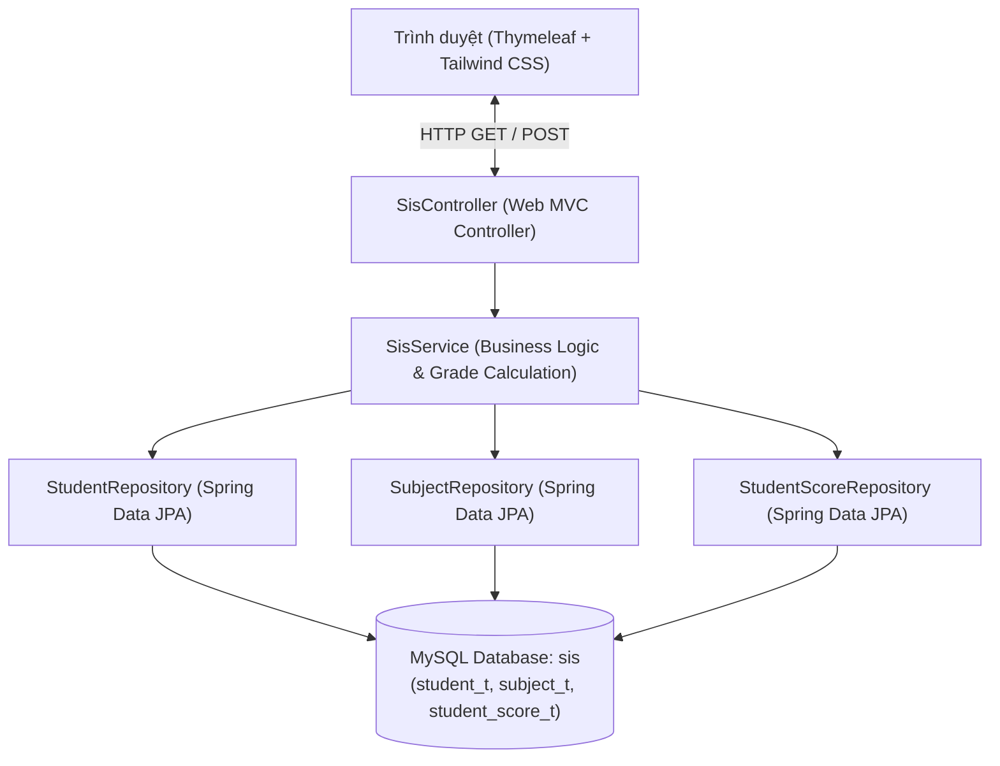
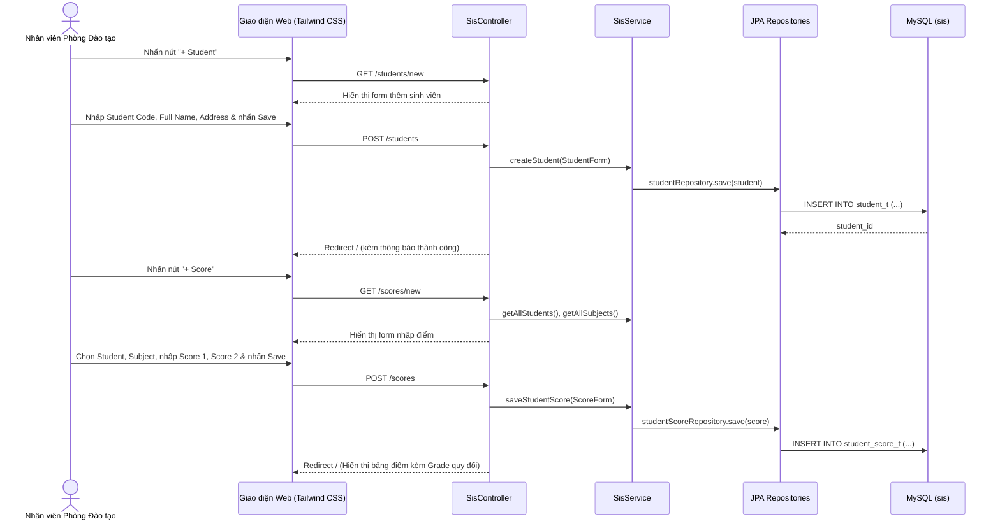
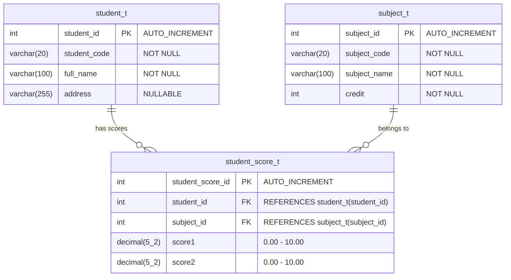

# Đặc Tả Dự Án & Kiến Trúc Hệ Thống (Project Specification & SA) — SIS

> **Tên dự án**: `KT_EAD` — Student Information System (`sis`)  
> **Môn thi**: Enterprise Application Development in Java EE (SET01)  
> **Thời lượng đề**: 90 phút | **Tổng điểm**: 15 điểm (kèm 1 điểm Bonus UI/UX)

---

## 1. Tổng quan Kiến trúc (Architecture Overview)

Hệ thống được xây dựng theo kiến trúc phân tầng chuẩn **Spring Boot MVC + Spring Data JPA (Hibernate)** kết hợp **Thymeleaf** và **Tailwind CSS** cho giao diện người dùng hiện đại, bám sát mẫu giao diện của đề bài nhưng nâng cấp trải nghiệm UI/UX đạt điểm tối đa.

### Công nghệ sử dụng (Tech Stack)
- **Ngôn ngữ**: Java 21
- **Framework**: Spring Boot 3.4.x (`spring-boot-starter-web`, `spring-boot-starter-data-jpa`, `spring-boot-starter-thymeleaf`, `spring-boot-starter-validation`)
- **Frontend UI**: Thymeleaf Template Engine + **Tailwind CSS** (với bảng màu xanh rêu/xanh lá đậm `#5b7857` chủ đạo theo đúng mẫu đề thi kết hợp bố cục hiện đại, responsive, badge điểm chữ trực quan)
- **Cơ sở dữ liệu**: MySQL 8.x (Database: `sis`) + H2 In-Memory fallback cho chạy kiểm thử tự động (Unit/Integration Test)
- **Build Tool**: Maven (`mvnw` / `pom.xml`)

---

## 2. Sơ đồ Thành phần (Component Diagram)



---

## 3. Sơ đồ Tuần tự (Sequence Diagrams)

### 3.1. Luồng Thêm Sinh viên (`+ Student`) & Nhập Điểm (`+ Score`)



---

## 4. Thiết kế Cơ sở dữ liệu (Database Design)

### 4.1. Sơ đồ Thực thể Liên kết (ERD)



### 4.2. Script SQL Chuẩn từ Đề bài (`sql/sis_schema_and_data.sql`)

```sql
CREATE DATABASE IF NOT EXISTS sis CHARACTER SET utf8mb4 COLLATE utf8mb4_unicode_ci;
USE sis;

CREATE TABLE IF NOT EXISTS student_t (
    student_id INT AUTO_INCREMENT PRIMARY KEY,
    student_code VARCHAR(20) NOT NULL,
    full_name VARCHAR(100) NOT NULL,
    address VARCHAR(255)
);

CREATE TABLE IF NOT EXISTS subject_t (
    subject_id INT AUTO_INCREMENT PRIMARY KEY,
    subject_code VARCHAR(20) NOT NULL,
    subject_name VARCHAR(100) NOT NULL,
    credit INT NOT NULL
);

CREATE TABLE IF NOT EXISTS student_score_t (
    student_score_id INT AUTO_INCREMENT PRIMARY KEY,
    student_id INT,
    subject_id INT,
    score1 DECIMAL(5,2),
    score2 DECIMAL(5,2),
    CONSTRAINT fk_student_id FOREIGN KEY (student_id) REFERENCES student_t(student_id),
    CONSTRAINT fk_subject_id FOREIGN KEY (subject_id) REFERENCES subject_t(subject_id)
);

-- Insert sample data
INSERT INTO subject_t (subject_code, subject_name, credit) VALUES
('JAVA', 'Java Programming', 4),
('PHP', 'PHP Programming', 3),
('WDA', 'Web Development and Applications', 3);

INSERT INTO student_t (student_code, full_name, address)
VALUES ('2007A10', 'Nguyễn Văn A', 'Hà Nội');

INSERT INTO student_score_t (student_id, subject_id, score1, score2)
VALUES (1, 1, 8.5, 7.0);
```

---

## 5. Thiết kế Entity & Công thức Quy đổi Điểm (Domain Model & Grade Logic)

### 5.1. Danh sách JPA Entities (Đáp ứng Question 1 & Question 2 — 6 điểm)
1. **`Student` (`org.aptech.sis.entity.Student`)**:
   - Ánh xạ bảng `student_t`
   - Các thuộc tính: `studentId` (`@Id @GeneratedValue`), `studentCode`, `fullName`, `address`, danh sách `scores` (`@OneToMany`).
2. **`Subject` (`org.aptech.sis.entity.Subject`)**:
   - Ánh xạ bảng `subject_t`
   - Các thuộc tính: `subjectId` (`@Id @GeneratedValue`), `subjectCode`, `subjectName`, `credit`.
3. **`StudentScore` (`org.aptech.sis.entity.StudentScore`)**:
   - Ánh xạ bảng `student_score_t`
   - Các thuộc tính: `studentScoreId` (`@Id @GeneratedValue`), `student` (`@ManyToOne` -> `student_id`), `subject` (`@ManyToOne` -> `subject_id`), `score1` (`BigDecimal`), `score2` (`BigDecimal`).

### 5.2. Thuật toán tính Điểm & Quy đổi Grade (Đáp ứng Question 3 — 2 điểm)
- **Công thức**:
  $$\text{GradeScore} = 0.3 \times \text{score1} + 0.7 \times \text{score2}$$
- **Hàm quy đổi sang chữ (`convertScoreToGrade`)**:
  - Nếu $\text{GradeScore} \ge 8.0 \rightarrow$ **`A`**
  - Nếu $6.0 \le \text{GradeScore} < 8.0 \rightarrow$ **`B`**
  - Nếu $4.0 \le \text{GradeScore} < 6.0 \rightarrow$ **`D`**
  - Nếu $\text{GradeScore} < 4.0 \rightarrow$ **`F`**

> **Ví dụ kiểm chứng với dữ liệu mẫu của đề**:
> - `score1 = 8.5`, `score2 = 7.0`
> - $\text{GradeScore} = 0.3 \times 8.5 + 0.7 \times 7.0 = 2.55 + 4.90 = 7.45$
> - Do $6.0 \le 7.45 < 8.0 \Rightarrow \text{Grade} = \text{\textbf{B}}$.

---

## 6. Thiết kế Giao diện với Tailwind CSS (UI/UX Specification — Bonus Point)

Để vừa tuân thủ đúng bố cục trong ảnh chụp đề bài (Header xanh rêu `Student Information System`, tiêu đề `Student Information`, 2 nút `+ Student` và `+ Score`, bảng 8 cột + cột icon cây bút) vừa đạt điểm tối đa phần **Bonus Point: Design good UI/UX (1 mark)**, giao diện được thiết kế với **Tailwind CSS**:
1. **Header Banner**: Tông màu xanh rêu đặc trưng của đề (`#5d7858` / Tailwind custom palette) kết hợp typography sắc nét, thống kê nhanh (Tổng số sinh viên, Tổng số môn học, Số bản ghi điểm, Điểm trung bình).
2. **Action Toolbar**:
   - Nút **`+ Student`** và **`+ Score`** nổi bật đúng vị trí góc trái trên bảng dữ liệu, có icon trực quan và hiệu ứng hover mượt mà.
   - Thanh tìm kiếm nhanh theo Mã SV / Tên SV / Môn học và bộ lọc theo `Grade` (`All`, `A`, `B`, `D`, `F`).
3. **Bảng dữ liệu (`Student Information Table`)**:
   - Đầy đủ các cột theo đúng thứ tự đề thi: `Id` | `Student Id` | `Student Name` | `Subject Name` | `Score 1` | `Score 2` | `Credit` | `Grade` | `Action (Edit icon)`.
   - Cột `Grade` hiển thị Badge màu sắc trực quan (`A`: Emerald/Green, `B`: Blue, `D`: Amber/Orange, `F`: Rose/Red) kèm tooltip điểm số hệ 10.
   - Cột cuối có nút icon cây bút (Edit) cho phép sửa nhanh điểm số.
4. **Danh sách Sinh viên & Môn học (Collapsible / Tabbed Cards)**:
   - Hiển thị danh sách sinh viên vừa thêm (kể cả sinh viên chưa có điểm) với nút gán điểm nhanh (`+ Add Score for this Student`).

---

## 7. Bảng đối chiếu Thang điểm Đề thi (Marking Schema Checklist)

| Câu hỏi | Yêu cầu chấm điểm | Điểm | Thành phần đáp ứng trong dự án |
| :--- | :--- | :-: | :--- |
| **Question 1** | Create Entity `Subject` & Create Entity `Student` | **3.0** | `Subject.java`, `Student.java` |
| **Question 1** | Insert Student from website (`+ Student`) | **3.0** | `GET/POST /students`, `student-form.html`, `SisService.saveStudent()` |
| **Question 2** | Create Entity `Score` (`StudentScore`) | **3.0** | `StudentScore.java` (`@ManyToOne` tới `Student` & `Subject`) |
| **Question 2** | Insert Score from website (`+ Score`) | **3.0** | `GET/POST /scores`, `score-form.html`, `SisService.saveScore()` |
| **Question 3** | Display information student | **1.0** | `GET /`, `index.html` hiển thị bảng thông tin sinh viên & điểm |
| **Question 3** | Convert score to Grade ($0.3 \times s_1 + 0.7 \times s_2 \rightarrow A/B/D/F$) | **1.0** | `GradeCalculator` / `StudentScore.getGrade()` |
| **Bonus Point** | Design good UI/UX (Tailwind CSS) | **1.0** | Giao diện Tailwind CSS hiện đại, chuẩn mẫu đề thi, có validate, toast message, tìm kiếm & chỉnh sửa |
| **Tổng cộng** | | **15.0** | |

